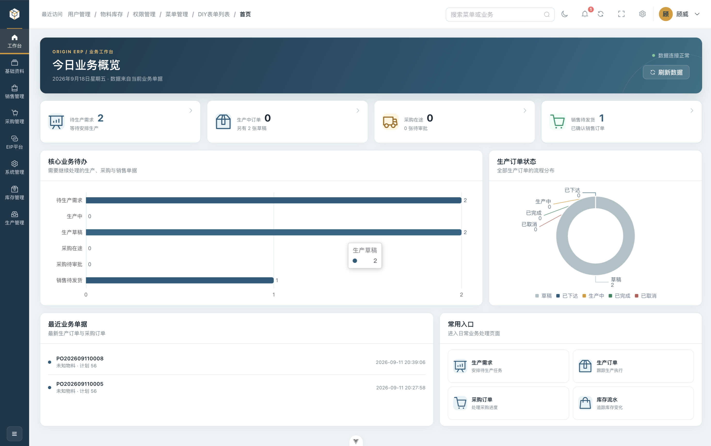
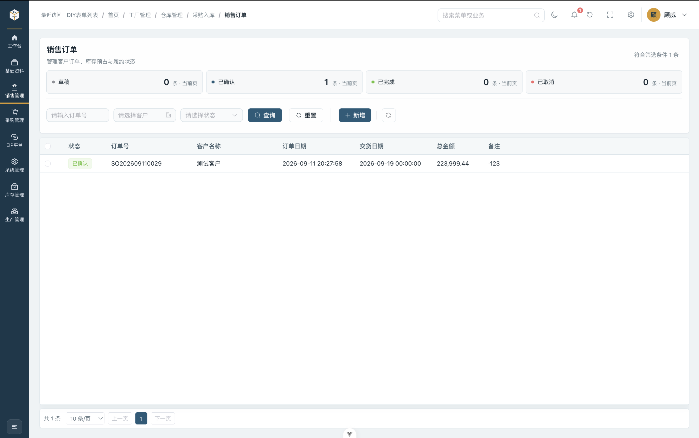
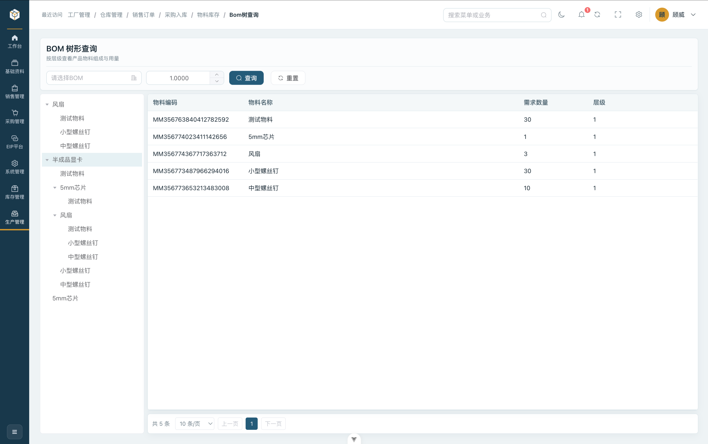
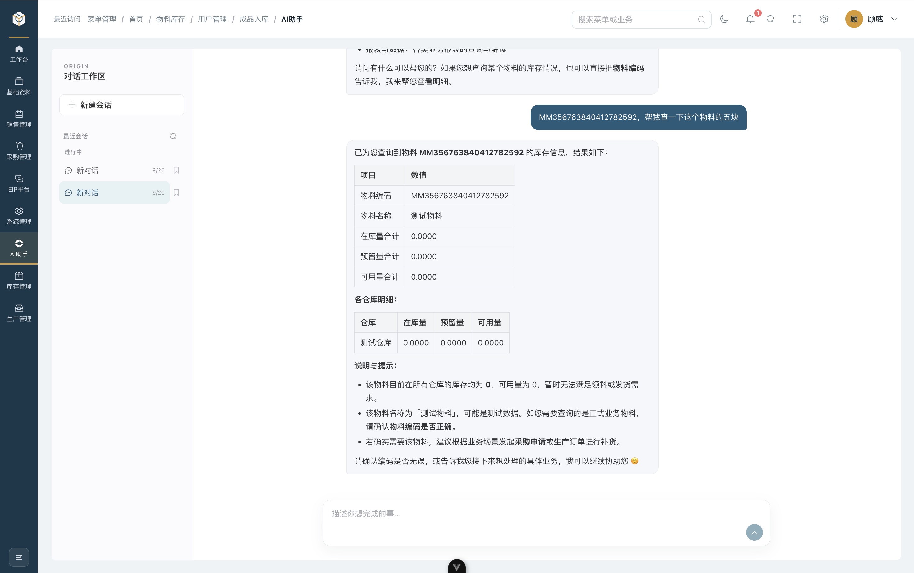

<div align="center">
  
  <h1>ORIGIN ERP · Web 管理端</h1>
  <p><strong>从业务计划到审批协同的统一工作台</strong></p>
  <p>围绕订单、物料和业务状态，连接销售、计划、采购与仓库。</p>
  <p>
    <a href="#在这里完成什么">产品能力</a> ·
    <a href="#本地运行">本地运行</a> ·
    <a href="docs/development.md">开发与集成文档</a>
  </p>
</div>

## 这是什么

ORIGIN ERP（原点智造）是一套连接订单、物料与现场作业的制造业务系统。Web 管理端面向销售、生产计划、采购、仓库管理和系统管理员，将基础资料、业务单据、审批与待办组织到一个工作空间中。

本仓库提供管理端界面和前端扩展入口。[服务端](https://github.com/weigu2700-cell/ORIGIN-ERP-BackEnd) 负责统一业务规则、数据及授权，[移动作业端](https://github.com/weigu2700-cell/ORIGIN-ERP-Moblie) 承接手机/PDA 上的扫码、领料、报工与出入库。三端共享账号、权限与业务状态。

## 在这里完成什么

| 工作场景       | 管理端提供的能力                                         |
| -------------- | -------------------------------------------------------- |
| 建立业务基础   | 维护客户、供应商、物料、仓库、工厂、车间和产线           |
| 管理订单与交付 | 创建、编辑与确认销售订单，跟踪销售出库和单据状态         |
| 安排生产       | 维护多级 BOM，查看物料需求，处理生产需求与生产订单       |
| 协同采购与仓储 | 处理采购需求/订单、入库审核与上架，查询库存及流水        |
| 跟进现场执行   | 查看生产领料、报工和成品入库，与移动端作业衔接           |
| 处理待办       | 查看实时通知、未读收件箱和通知详情，配置通知模板与收件人 |
| 查询业务       | 使用工作台、菜单搜索和 AI 助手查找数据、核对待确认动作   |
| 管理组织与访问 | 配置用户、部门、角色、菜单和权限，查看当前组织并退出切换 |

单据界面随状态展示可用操作；页面入口按授权菜单生成，实际操作由后端再次检查权限与业务条件。一个岗位看到的工作台和可用动作取决于其账号授权。

### 从计划到现场

```text
Web：维护资料 → 管理订单 / BOM / 需求 → 审核与下达 → 查看执行与库存
                                ↕ 同一后端与业务单据
移动端：扫码查询 → 领料 / 报工 / 出入库 → 现场结果回到单据
```

### 界面预览

<div align="center">
  
  <p>从工作台进入日常业务与待办</p>
</div>

<table>
  <tr>
    <td width="50%"></td>
    <td width="50%"></td>
  </tr>
  <tr>
    <td align="center">围绕订单查看明细和推进状态</td>
    <td align="center">从产品结构核对物料需求</td>
  </tr>
</table>

<div align="center">
  
  <p>在当前账号权限范围内查询业务，涉及动作时先确认</p>
</div>

## 当前使用范围

Web 管理端持续迭代，默认配合后端 single 模式运行现有制造业务。业务助手需要部署方配置可用的模型服务；知识库检索仍在开发中。

多组织已具备编码核验、最近组织、当前组织展示和退出重登流程。**当前后端 multi 模式仅开放组织身份链路，正式业务尚未开放**；登录后显示真实组织及“当前组织暂未开放业务”，不会加载业务菜单、看板、通知或 AI。

完整产品范围、数据库准备及多租户交付状态见 [产品与服务端说明](https://github.com/weigu2700-cell/ORIGIN-ERP-BackEnd)。

## 本地运行

### 准备后端与开发环境

- Node.js `^22.18.0` 或 `>=24.12.0`，npm 10+。
- 已完成数据库初始化并启动的配套服务端。
- 后端应提供组织配置、组织核验、登录和当前会话接口；接口清单见 [开发参考](docs/development.md)。

```bash
git clone https://github.com/weigu2700-cell/ORIGIN-ERP--FrontEnd.git
cd ORIGIN-ERP--FrontEnd
npm ci
```

### 配置接口并启动

在仓库根目录创建 `.env.development.local`，覆盖本机后端地址：

```dotenv
VITE_API_URL=http://localhost:8080
# 可选：WebSocket 使用独立网关时指定
# VITE_WS_URL=ws://localhost:8080/ws/notification
```

```bash
npm run dev
```

聊天（页头「消息」入口，路由 `/message`）依赖后端聊天模块的 `/im/*` 与 `/ws/chat`。后端聊天接口上线前，可用内存 Mock 联调界面：

```bash
VITE_IM_MOCK=1 npm run dev
```

打开终端输出的地址，通常为 <http://localhost:5173>。`VITE_` 变量会写入浏览器产物，只保存服务地址等公开配置。

### 首次登录

single 模式自动显示后端默认组织。执行过开发 seed 的空库可使用 `admin` / `OriginDev@123`；已有账号使用原密码，生产环境使用部署方创建的账号。Flyway 新租户没有通用默认密码。

multi 模式输入管理员提供的组织编码，核验名称后使用该组织账号登录；本地保留最多 5 个成功登录组织，不公开枚举全部企业。页头切换组织会退出并重新登录，未提交内容不会保留。

首次体验建议依次核对组织/用户、基础资料、一个测试单据及对应通知，再使用受限角色检查菜单与动作范围。

## 面向开发者

前端使用 Vue 3、TypeScript、Vite、Element Plus、Vue Router 和 Pinia，网络请求由 Axios 统一封装。实际依赖与脚本以 [package.json](package.json) 为准。

| 开发入口                            | 职责                                  |
| ----------------------------------- | ------------------------------------- |
| `src/views`、`src/api`、`src/types` | 按业务域组织页面、接口和类型          |
| `src/components`、`src/refer`       | 共享查询、表格、单据容器与业务参照    |
| `src/router`、`src/stores`          | 动态菜单、权限、当前组织和会话状态    |
| `src/layout`、`src/styles`          | 工作区布局、主题与品牌配色            |
| `src/utils`、`src/__tests__`        | 请求、WebSocket、会话边界与自动化回归 |

### 扩展一个业务页面

1. 先明确业务角色、单据状态及后端接口，沿用统一响应和字符串 ID 约定。
2. 在 `api`、`types` 和 `views` 对应业务域增加实现，复用 `ProTable`、`ProSearch`、`ReferPicker` 等现有组件。
3. 配置后端菜单/操作权限，数据库变更新增 Flyway 版本；前端按钮权限配合后端规则。
4. 验证加载、空数据、请求失败、无权限、写入结果和组织切换，补充有意义的回归。

退出/切换会清理权限、动态路由和私有状态，取消旧请求、WebSocket 及 AI 流；晚到的旧响应不能覆盖当前组织。通知连接支持退避重连，多条业务待办保留独立记录并合并实时提示。实现细节见 [开发与集成参考](docs/development.md)。

### 开发检查

```bash
npm run type-check
npm run test:unit -- --run
npm run build
```

`npm run lint` 会自动修复代码，提交前的 Husky/lint-staged 仅检查暂存文件。其他脚本见 `package.json`。生产构建通过与类型检查通过分别确认，当前已知依赖问题及回归范围记录在 [验证说明](docs/development.md#消息通知测试)。

## 部署与集成

通过 `.env.production` 或构建环境配置 `VITE_API_URL`；如果通知使用独立地址，再配置 `VITE_WS_URL`。运行 `npm run build` 后部署 `dist/`。

静态服务器需将前端路由回退到 `index.html`，包括 `/notification/detail/:id`；网关同时转发 REST、AI SSE 和 `/ws/notification`，并为 WebSocket 配置协议升级。HTTPS 页面使用 WSS，部署顺序为数据库迁移 → 后端 → 前端。具体代理与会话规则见 [部署说明](docs/development.md#部署说明)。

部署验收应覆盖不同角色、真实单据、刷新/直达链接、通知恢复和组织切换。多租户业务以服务端开放状态为准。

## 文档与参与

- [开发与集成参考](docs/development.md)：目录结构、请求约定、动态路由、通知与扩展规范。
- [产品、API 与数据库维护](https://github.com/weigu2700-cell/ORIGIN-ERP-BackEnd)：整体能力、部署方式及后端文档。
- [移动作业端](https://github.com/weigu2700-cell/ORIGIN-ERP-Moblie)：手机/PDA 作业与目标设备验收。

在 [Issues](https://github.com/weigu2700-cell/ORIGIN-ERP--FrontEnd/issues) 中描述业务场景、使用角色和预期行为；界面问题附复现步骤、浏览器及视口信息。PR 请说明业务变化、配套接口/迁移和验证结果，并移除凭据与企业敏感数据。

本仓库采用 [MIT License](LICENSE)。
