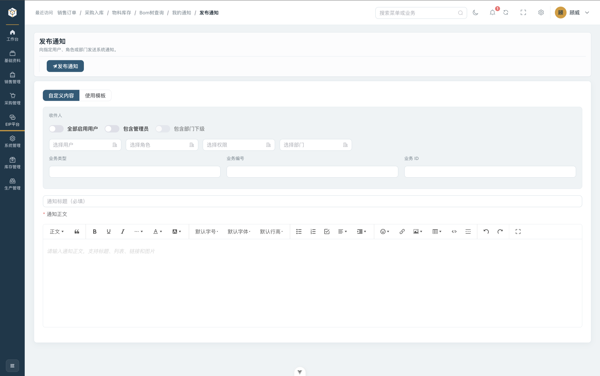

<div align="center">
  

  <h1>ORIGIN ERP Web</h1>

  <p>面向制造企业的现代化 ERP 管理端，以订单为核心串联销售、采购、库存、BOM 与生产执行。</p>

  <p>
    
    
    
    
  </p>
</div>

## 项目简介

ORIGIN ERP Web 是原点 ERP 的桌面管理端。项目采用 Vue 3、TypeScript、Vite 和 Element Plus 构建，通过后端菜单与权限动态生成业务导航，并提供统一的查询、表格、参照选择、单据详情和状态流转体验。

配套项目：

- [ORIGIN ERP 后端](https://github.com/weigu2700-cell/ORIGIN-ERP-BackEnd)
- [ORIGIN ERP 移动端](https://github.com/weigu2700-cell/ORIGIN-ERP-Moblie)

## 项目亮点

- **制造业务闭环**：销售订单、生产需求、BOM、生产订单、领料、采购和库存围绕同一业务链路协同。
- **权限驱动路由**：登录后根据当前用户菜单生成路由和侧边栏，并兼容驼峰、帕斯卡、下划线及历史菜单路径。
- **组织选择与会话隔离**：登录前核验组织编码，记录最近成功登录的组织；页头展示当前组织，切换时退出重登，并取消旧组织请求、WebSocket 与 AI 流。
- **订单化交互**：销售、采购、生产相关详情采用统一单据结构，突出单号、状态、业务摘要、明细和金额。
- **状态流转可视化**：订单确认、审核、下达、开工、完工、取消、上架等操作随当前状态动态显示。
- **高复用业务组件**：沉淀 `ProTable`、`ProSearch`、`ProToolbar`、`ProTree`、`ReferPicker` 和单据详情容器。
- **类型安全**：接口、查询条件和业务实体集中建模；雪花 ID 全程按字符串处理，避免 JavaScript 精度损失。
- **实时消息通知**：登录后建立 WebSocket 连接，Pinia 统一维护最近消息与未读数量，支持铃铛提醒、通知中心、独立详情页和已读操作。
- **AI 业务助手**：支持会话管理与归档、自然语言查询物料库存，并将回答中的表格、列表和代码块清晰展示。
- **自动质量门禁**：ESLint、Oxlint、Prettier、Husky 和 lint-staged 在提交前自动检查并修复代码。
- **一致的视觉系统**：支持深浅主题、品牌配色、响应式布局和制造业工作台。
- **自适应页头**：组织与用户名限宽，较窄窗口收起部分工具，长访问记录自动省略并优先保留当前页面，避免面包屑被挤出容器。

## 功能模块

| 模块     | 主要能力                                                                     |
| -------- | ---------------------------------------------------------------------------- |
| 工作台   | 业务概览看板、用户信息展示、深浅主题切换、全局菜单搜索                       |
| 组织会话 | 组织编码核验、最近组织、当前组织展示、退出切换、旧请求隔离与组织未开放提示   |
| 系统管理 | 用户管理、角色管理、部门管理、菜单配置、权限定义与角色授权                   |
| 基础资料 | 客户、供应商、物料、仓库、工厂、车间、生产线、物料供应商的增删改查与关联维护 |
| 销售管理 | 销售订单新增/编辑/确认/取消、销售出库及全流程状态流转                        |
| 库存管理 | 物料库存查询、库存明细、库存流水追踪、成品入库与数据导入导出                 |
| BOM 管理 | BOM 新增与编辑、多级树形结构展示、启用/停用、物料需求展开                    |
| 生产管理 | 生产需求生成、生产订单下达/开工/完工/取消、生产领料、生产报工                |
| 采购管理 | 采购需求、采购订单新增/编辑、采购入库审核与上架、状态流转                    |
| 消息通知 | WebSocket 实时推送、未读角标提醒、通知中心、通知详情、单条/全部已读          |
| AI 助手  | 多轮对话、会话归档、物料库存查询与结构化回答展示                             |

## 项目截图

<div align="center">
  
  <p><em>工作台 — 业务概览看板、用户信息展示与全局菜单搜索</em></p>

  
  <p><em>销售订单 — 订单列表、新增/编辑、确认/取消与状态流转</em></p>

  
  <p><em>BOM 管理 — 多级树形结构、物料需求展开与启用/停用</em></p>

  
  <p><em>消息通知 — WebSocket 实时推送、未读角标与通知中心</em></p>

  
  <p><em>AI 助手 — 自然语言查询物料库存并展示库存明细与业务提示</em></p>
</div>

## 技术栈

| 分类       | 技术                                      |
| ---------- | ----------------------------------------- |
| 核心框架   | Vue 3.5、Composition API                  |
| 开发语言   | TypeScript 6                              |
| 构建工具   | Vite 8                                    |
| UI 组件    | Element Plus 2.14                         |
| 路由与状态 | Vue Router 5、Pinia 4                     |
| 网络请求   | Axios                                     |
| 实时通信   | 浏览器原生 WebSocket                      |
| 数据可视化 | ECharts                                   |
| 工程质量   | ESLint、Oxlint、Prettier、vue-tsc、Vitest |
| Git 工作流 | Husky、lint-staged                        |

## 快速开始

### 环境要求

- Node.js `^22.18.0` 或 `>=24.12.0`
- npm 10+
- 已启动的 [ORIGIN ERP 后端](https://github.com/weigu2700-cell/ORIGIN-ERP-BackEnd)

### 安装与启动

```bash
git clone https://github.com/weigu2700-cell/ORIGIN-ERP--FrontEnd.git
cd ORIGIN-ERP--FrontEnd

npm ci
npm run dev
```

开发地址以终端输出为准，通常为 <http://localhost:5173>。

### 环境变量

开发环境默认读取 `.env.development`：

```dotenv
VITE_API_URL=http://localhost:8080
# 可选。未配置时会基于 VITE_API_URL 自动生成 ws://localhost:8080/ws/notification
VITE_WS_URL=ws://localhost:8080/ws/notification
```

生产部署时在 `.env.production` 或部署平台中设置真实接口地址：

```dotenv
VITE_API_URL=https://api.example.com
# 前后端不在同一网关或 WebSocket 使用独立域名时配置
VITE_WS_URL=wss://api.example.com/ws/notification
```

`VITE_WS_URL` 是可选项。未配置时，客户端使用 `VITE_API_URL` 拼接 `/ws/notification`，并自动将 `http/https` 转换为 `ws/wss`。生产环境必须通过 HTTPS 页面连接 WSS，避免浏览器阻止混合内容。

> `VITE_` 前缀变量会进入浏览器产物，请勿在其中保存密码、Token 或其他密钥。

### 组织登录与后端配套

前端不设置自己的 single/multi 开关，以后端 `GET /auth/tenant/context` 为准，需要使用包含以下组织接口的配套后端：

| 接口                        | 用途                                             |
| --------------------------- | ------------------------------------------------ |
| `GET /auth/tenant/context`  | 读取运行模式，single 返回默认组织                |
| `POST /auth/tenant/resolve` | 用 `tenantCode` 核验组织编码与名称               |
| `POST /auth/login`          | 提交 `tenantCode`、账号、密码并获取 JWT          |
| `GET /auth/tenant/session`  | 获取当前组织、基础用户身份与 `businessAvailable` |

- **single**：自动使用后端默认组织，仍以原账号密码登录。旧单企业开发 seed 的账号为 `admin` / `OriginDev@123`，仅适用于显式运行该 seed 的开发库；新租户使用开通时指定的管理员账号，没有统一默认密码。
- **multi**：首次输入管理员提供的组织编码，确认解析名称后登录；本地最多记录 5 个成功登录组织，没有公开全部企业的列表。
- **切换组织**：在页头选择最近组织或“使用其他组织编码”，确认退出后重新登录。未提交表单不会保留；不能只改变显示名称或请求头来切换数据库。
- **组织暂未开放**：当前后端 multi 仍返回 `businessAvailable=false`，主页显示真实组织和用户，提示“当前组织暂未开放业务”，不加载业务菜单、看板、通知或 AI。显示组织入口不代表完整多租户业务已经上线。

首次部署先按 [后端数据库初始化与多租户说明](https://github.com/weigu2700-cell/ORIGIN-ERP-BackEnd#组织与多租户) 准备目标数据库。组织加载/核验失败时可在登录页重试，不要手工写入 Token 绕过校验。

## 常用命令

| 命令                 | 说明                            |
| -------------------- | ------------------------------- |
| `npm run dev`        | 启动开发服务器                  |
| `npm run type-check` | 检查 TypeScript 与 Vue 模板类型 |
| `npm run lint`       | 执行 Oxlint 与 ESLint 自动修复  |
| `npm run format`     | 使用 Prettier 格式化项目        |
| `npm run test:unit`  | 运行 Vitest 单元测试            |
| `npm run build`      | 并行执行类型检查与生产构建      |
| `npm run build-only` | 仅执行 Vite 生产构建            |
| `npm run preview`    | 本地预览生产产物                |

安装依赖后 Husky 会自动启用。提交时 lint-staged 只检查暂存的前端文件，并自动执行 ESLint 与 Prettier。

## 项目结构

```text
src/
├── api/          # 按业务域划分的接口封装
├── components/   # 通用页面、表格、工具栏和单据组件
├── composables/  # 可复用组合式逻辑
├── layout/       # 顶栏、侧边栏、面包屑和基础布局
├── refer/        # 客户、物料、仓库、订单等参照选择器
├── router/       # 静态路由、动态路由解析和守卫
├── stores/       # 用户、权限、应用状态和通知状态
├── styles/       # 全局样式和主题变量
├── types/        # 接口 DTO、VO 与业务类型
├── utils/        # 请求、认证、存储和图标工具
└── views/
    ├── home/      # 工作台
    ├── system/    # 系统管理
    ├── master/    # 基础资料
    ├── inventory/ # 库存管理
    ├── sales/     # 销售管理
    ├── purchase/  # 采购管理
    ├── eip/       # 消息通知中心、通知详情、自定义表单
    ├── product/   # BOM 与生产管理
    └── profile/   # 个人中心
```

## 核心设计

### 动态菜单与权限

```text
读取模式 → 核验组织 → 登录 → 获取组织会话
                               ├── 业务已开放：用户/菜单 → 动态路由 → 业务页面
                               └── 业务未开放：组织主页与状态提示
```

菜单决定页面入口，后端 Permission 与 Spring Security 决定接口操作权限。菜单组件路径支持以下写法：

```text
master/material
master/material/index
product/Bom/BomManagement/index
product/bom/bom_management/index
```

### 统一请求层

页面只调用 `src/api` 中的业务接口。`src/utils/request.ts` 负责：

- 自动添加 Bearer Token；
- 解包后端统一响应；
- 统一处理业务异常和网络异常；
- 在当前会话登录失效时清理会话并返回登录页；
- 切换会话时取消旧请求，拦截晚到的成功响应和 401，防止旧组织覆盖当前数据或退出新会话；
- 匿名登录/组织核验请求不携带旧组织凭据。

退出和切换同时清理用户、权限、动态路由、访问记录与通知状态；AI SSE 流和旧 WebSocket 回调绑定会话。最近组织只保留编码与名称，不能作为授权依据。实现主要位于 `src/stores/organization.ts`、`src/stores/user.ts`、`src/utils/auth.ts` 与 `src/utils/request.ts`。

### 通用业务页面

列表页优先组合通用组件：

```text
ProPageHeader + ProSearch + ProToolbar + ProTable + ReferPicker
```

订单详情统一使用 `BusinessDocumentDialog`，使销售、采购和生产单据拥有一致的信息层级与操作体验。

### 消息通知与 WebSocket

消息通知采用“REST 初始化与操作 + WebSocket 增量推送”的组合方式：

```text
进入业务已开放的 BasicLayout
   ├── REST：并行加载未读数量与最近 6 条通知
   └── WebSocket：连接 /ws/notification?token=<JWT>
                         │
                         ▼
                  收到 NotificationItem
                         │
                         ▼
              Pinia 去重、插入列表、累加未读数
                         │
             ┌───────────┴───────────┐
             ▼                       ▼
       Header 铃铛角标          合并为一个实时提醒
```

主要实现位置：

| 文件                                                       | 职责                                           |
| ---------------------------------------------------------- | ---------------------------------------------- |
| `src/utils/websocket.ts`                                   | 建立单例连接、附加 JWT、解析推送并在退出时断开 |
| `src/stores/notification.ts`                               | 管理最近通知、未读数、去重、单条已读和全部已读 |
| `src/layout/components/NotificationPopover.vue`            | Header 铃铛、未读角标和最近通知入口            |
| `src/views/eip/notification/notificationList/index.vue`    | 通知中心、已读筛选、分页和批量操作             |
| `src/views/eip/notification/notificationDetail/detail.vue` | 按 ID 查询详情并提供“标记已读”操作             |
| `src/api/eip/notification.ts`                              | 通知 REST API 封装                             |

页面与接口：

| 能力     | 前端地址/调用                        | 说明                                       |
| -------- | ------------------------------------ | ------------------------------------------ |
| 通知中心 | `/notification/list`                 | 全部、未读、已读筛选与分页                 |
| 通知详情 | `/notification/detail/:id`           | 支持浏览器刷新和直接访问                   |
| 未读数量 | `GET /sys/notification/unread/count` | 驱动铃铛右上角数量角标，超过 99 显示 `99+` |
| 单条已读 | `PUT /sys/notification/{id}/readed`  | 成功后同步更新列表及未读数                 |
| 全部已读 | `PUT /sys/notification/all/readed`   | 清空当前用户未读数                         |

WebSocket 只负责实时增量通知，不替代数据库与 REST 接口。连接异常关闭后按 1 秒起、最多 30 秒的退避重连；网络恢复或页面重新可见时重新检查连接并同步 REST 状态。退出/切换会关闭旧连接、取消重连和清理通知，不接受旧 Token 连接的晚到消息。

一次生产下达可能按 BOM 产生多张单据及不同待办，这些业务通知仍逐条保存、按 ID 去重并计入未读数；同一时段的提醒合并显示数量，避免一次操作弹出二十多个提示。合并提示不等于丢弃通知。

### 消息通知测试

通知模块包含页面、详情和 Pinia 状态测试，主要覆盖：

- 全部、未读、已读筛选和分页参数；
- 单条与全部已读后的状态同步；
- WebSocket 消息去重、最近 6 条截断及未读数累加；
- 雪花 ID 字符串透传；
- 独立详情加载和详情页标记已读。

可单独运行全部单元测试：

```bash
npm run test:unit -- --run
```

组织与会话回归还覆盖同用户 ID 的切换、较早的组织核验晚返回、用户信息晚返回、权限/访问状态清理、旧请求 200/401，以及 AI 流的会话边界。布局可在 Web 宽度 960、1024、1280、1440、1920 下，配合长组织名、长用户名和多条访问记录复核。

最近一次验证（2026-11-03）：49 项单元测试及 `build-only` 通过。当前依赖安装下 `type-check` 在未改动的 `RichTextEditor.vue` 报 `@wangeditor/editor-for-vue` 的类型导出解析错误（TS7016）；生产构建通过不替代类型检查，发布前仍需解决并重新运行该检查。

## 开发规范

- 使用 `<script setup lang="ts">` 和 Composition API。
- API、类型和页面按业务域组织，页面不直接调用 Axios。
- 相邻函数之间保留一个空行，简单模板插值保持紧凑。
- 状态操作必须同时校验当前选中记录和允许流转的业务状态。
- 后端 `Long` 主键在前端统一使用字符串，不执行 `Number(id)` 转换。
- 提交前至少执行 `npm run type-check` 和 `npm run build-only`。

## 部署说明

- SPA 服务器需要将未知前端路由回退到 `index.html`，否则直接访问 `/notification/detail/:id` 会返回 404。
- 反向代理需要同时转发 REST 请求与 `/ws/notification`，并启用 WebSocket Upgrade/Connection 请求头。
- 推荐让 REST 与 WebSocket 共用同一 HTTPS 域名；如使用独立地址，通过 `VITE_WS_URL` 指定完整 `wss://` URL。
- `VITE_` 环境变量会写入浏览器构建产物，不得存放数据库密码、JWT 密钥或其他服务端凭据。
- 先部署配套后端与目标数据库迁移，再发布前端；多租户业务的开放以服务端验收和 `businessAvailable` 为准。

## 未来期望

- **零代码表单建设**：提供可视化拖拽表单设计器，支持自定义字段、校验规则与业务流程编排，零代码快速搭建业务表单与审批单据。
- **AI 能力扩展**：在现有智能问答与库存查询基础上，逐步增加报表摘要和运营建议，辅助制造决策。

## 参与贡献

1. Fork 仓库并创建功能分支：`git checkout -b feature/your-feature`
2. 完成功能并执行类型检查、Lint 和构建
3. 使用清晰的提交信息，例如：`feat: add production picking workflow`
4. 推送分支并创建 Pull Request，说明改动目的、影响范围和验证方式

问题与建议请提交到 [GitHub Issues](https://github.com/weigu2700-cell/ORIGIN-ERP--FrontEnd/issues)。
